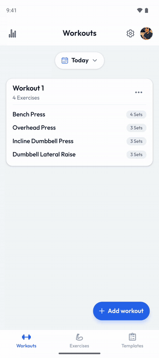
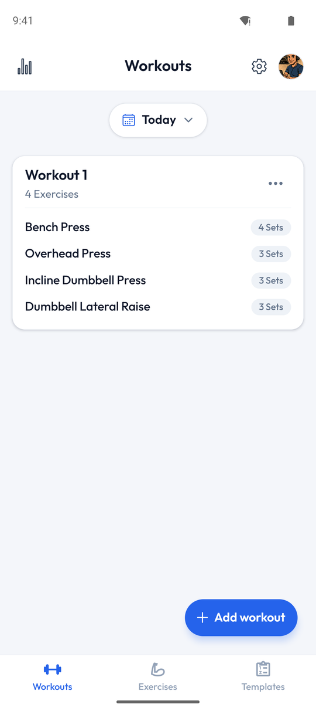
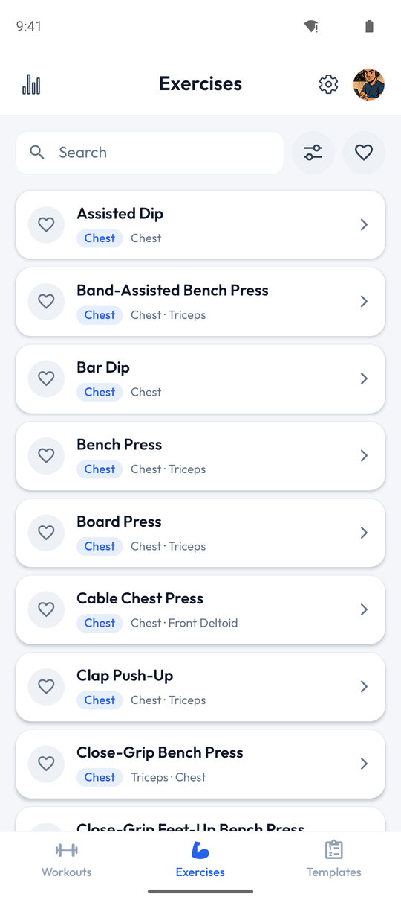
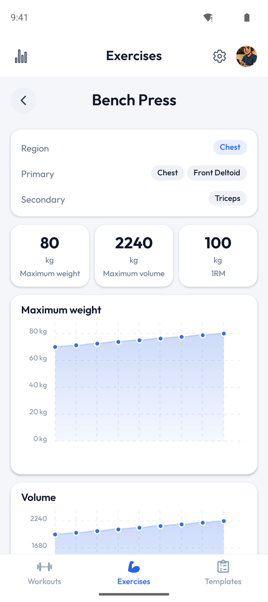
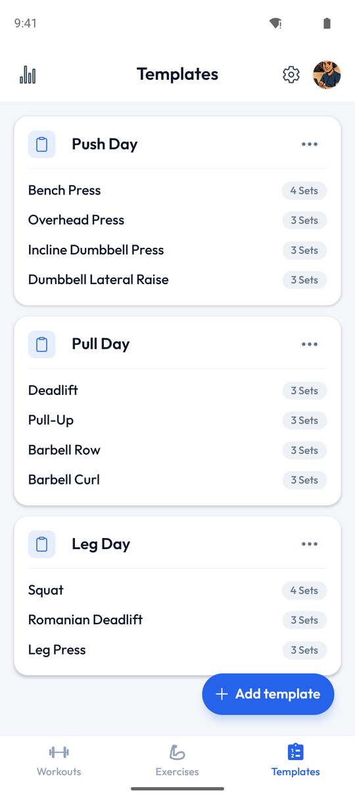
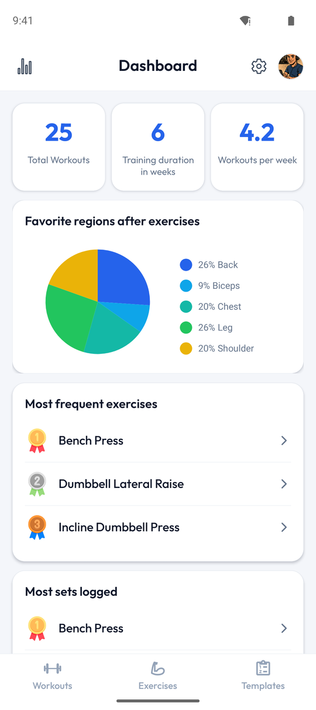
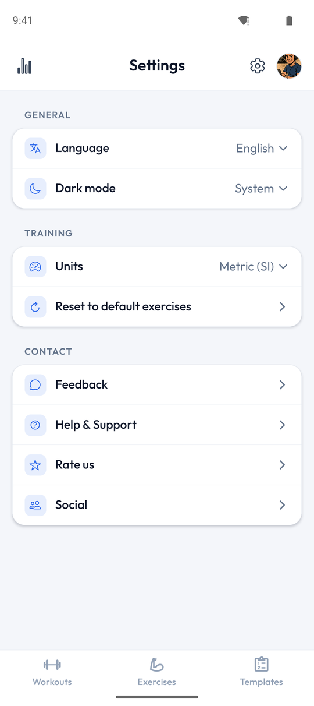
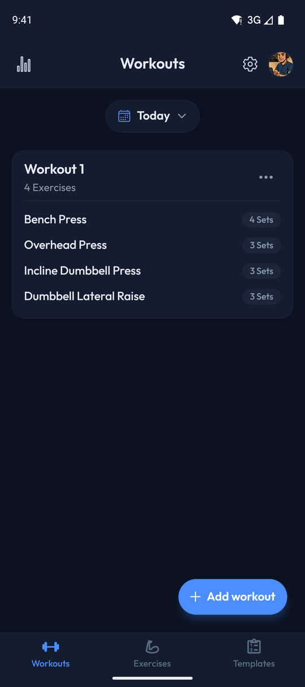
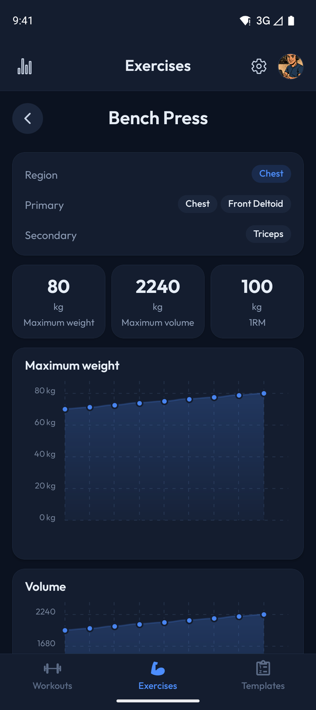
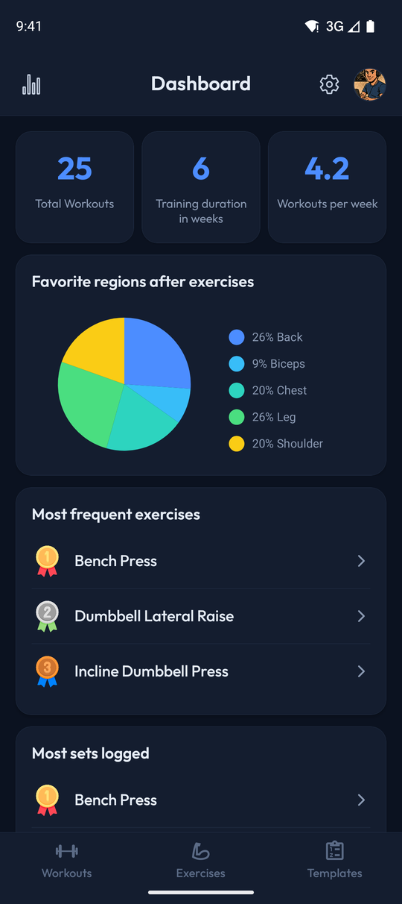

# GymLogger

A mobile app for logging gym workouts, managing reusable workout templates, and tracking progress per exercise. All data is stored locally on the device.

<p align="center">
  
</p>

## Screenshots

<table>
  <tr>
    <td align="center"><br><sub>Workouts</sub></td>
    <td align="center"><br><sub>Exercise library</sub></td>
    <td align="center"><br><sub>Exercise progress</sub></td>
  </tr>
  <tr>
    <td align="center"><br><sub>Templates</sub></td>
    <td align="center"><br><sub>Dashboard</sub></td>
    <td align="center"><br><sub>Settings</sub></td>
  </tr>
</table>

<details>
<summary>Dark mode</summary>

<table>
  <tr>
    <td align="center"><br><sub>Workouts</sub></td>
    <td align="center"><br><sub>Exercise progress</sub></td>
    <td align="center"><br><sub>Dashboard</sub></td>
  </tr>
</table>

</details>

## Technologies

- **[Expo](https://expo.dev) / React Native** (TypeScript): cross-platform app for Android, iOS and web
- **[Expo Router](https://docs.expo.dev/router/introduction)**: file-based navigation with a bottom tab bar
- **[expo-sqlite](https://docs.expo.dev/versions/latest/sdk/sqlite/)**: local database for exercises, workouts, templates and sets
- **[react-native-chart-kit](https://github.com/indiespirit/react-native-chart-kit)**: progress charts and dashboard statistics
- **[i18next](https://www.i18next.com/) / react-i18next**: translations (English and German)
- **AsyncStorage**: persisted user settings (language, theme, units)

## Getting started

1. Install dependencies

   ```bash
   npm install
   ```

2. Start the development server

   ```bash
   npx expo start
   ```

3. Open the app on an [Android emulator](https://docs.expo.dev/workflow/android-studio-emulator/), [iOS simulator](https://docs.expo.dev/workflow/ios-simulator/), a [development build](https://docs.expo.dev/develop/development-builds/introduction/) or [Expo Go](https://expo.dev/go). You can also use `npm run android`, `npm run ios` or `npm run web`.

## Using the app

### Logging a workout (Workouts tab)

1. Tap the **date button** at the top to pick the day you want to log (it defaults to today).
2. Tap **Add workout** and choose:
   - **Custom**: start an empty workout.
   - **Template**: pick a saved template; its exercises and sets are copied into a new workout.
3. In the workout, tap **Add exercise**, search for and select an exercise, then use **Add set** to enter reps and weight. Tap **Confirm** to save it.
4. Back on the Workouts tab, open a workout card's menu to **Edit** or **Delete** it.

A workout with no exercises is discarded automatically when you leave it.

### Creating templates (Templates tab)

1. Tap **Add template**, then add exercises and their sets the same way as in a workout.
2. Use a template card's menu to **Edit**, **Rename** or **Delete** it.
3. Start a workout from a template via **Add workout → Template** on the Workouts tab.

### Browsing exercises (Exercises tab)

- **Search** exercises by name.
- Tap the **filter** button to filter by body region and by primary or secondary target muscles.
- Tap the **heart** button to show only favorites.
- Tap an exercise to open its detail page, which shows target muscles, maximum weight and maximum volume, and charts of your progress over time (max weight, volume and total reps).

### Dashboard

Open it with the button in the top-left of the header. It shows total workouts, the date you started training, workouts per week, the split of trained body regions, and your most frequently trained exercises.

### Settings and profile

The buttons in the top-right of the header open:

- **Settings**: language (English or German), dark mode (on, off or system), units (metric or imperial), and resetting the exercise list to the defaults.
- **Profile**: body measurements.

## Scripts

| Command           | Description                       |
| ----------------- | --------------------------------- |
| `npm start`       | Start the Expo development server |
| `npm run android` | Start and open on Android         |
| `npm run ios`     | Start and open on iOS             |
| `npm run web`     | Start and open in the browser     |
| `npm run lint`    | Run ESLint                        |
